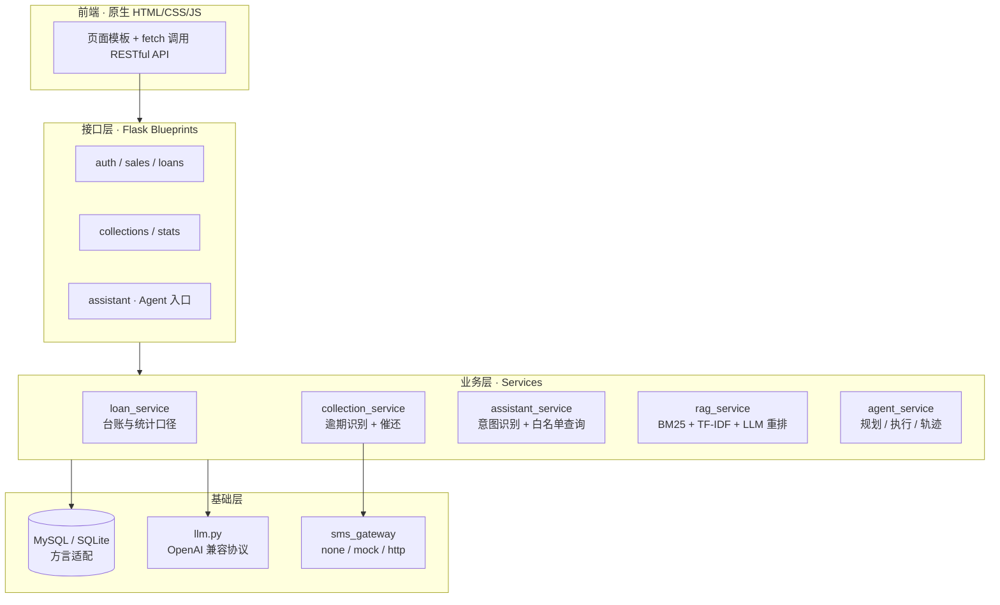
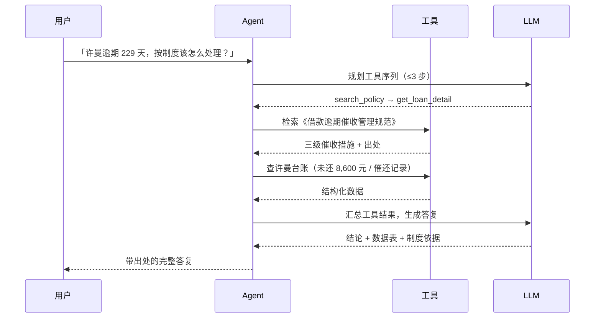

<div align="center">

# 智析 FinSight AI

**面向企业财务场景的「借资台账 + 智能催收 + 制度问答」一体化系统**

用 Flask + MySQL + LLM 把「白名单统计 / 制度检索 / 人员台账」三类工具串成可解释的 Agent 链路。


[功能](#功能) · [架构](#架构) · [快速开始](#快速开始) · [测试](#测试) · [设计取舍](#设计取舍)

</div>

---

## 这是什么

公司销售常以「差旅借款 / 市场推广借款 / 备用金 / 项目周转」等名义向财务借资，逾期不还时需要人工催收；财务想看数据又不会写 SQL。这个项目解决三件事：

1. **借资台账**：借资、还款、逾期全流程管理，金额与状态始终由还款流水汇总重算；
2. **智能催收**：扫描逾期记录 → LLM 生成催还短信 → 短信网关下发，**LLM 不可用时自动降级为规则模板**；
3. **自然语言问数**：支持 9 类统计查询、4 份财务制度的条款问答（带出处）、以及「查制度 + 查台账」的混合问题。

> 一句话：**不是「接了个大模型 API」，而是围绕大模型的不确定性做了一整套工程约束。**

## 功能

| 模块 | 能力 |
| --- | --- |
| 数据看板 | 核心指标卡、部门/类型/趋势/账龄图表、TOP 欠款、一键催还 |
| 借资管理 | 增删改查、多条件检索、还款登记、单笔催还、CSV 导出、逻辑删除 |
| 催还管理 | 逾期扫描、批量生成、短信下发与重发、催还记录查询 |
| AI 助手 | 多工具 Agent：统计查询 / 制度问答（带出处）/ 混合多步调用，展示执行轨迹与引用片段 |
| 权限与审计 | 管理员 / 财务 / 销售三角色，操作日志全量记录 |
| 系统状态 | 数据库、LLM、短信配置状态与业务参数可视化 |

## 架构



### AI 链路：从 NL2SQL 到 Agent



**为什么混合问题必须走 Agent**：纯 NL2SQL 只能查数，纯 RAG 只能答制度；「依据制度给出针对某人的处理建议」必须两步取数再合成，这正是编排的价值。

## 快速开始

**零依赖体验（SQLite，无需 MySQL）**：

```bash
pip install flask
python init_db.py sqlite   # 建表 + 导入演示数据 + 4 份制度文档入库
python run.py              # 打开 http://127.0.0.1:5000
```

默认账号：`admin / admin123`（管理员）、`finance / finance123`（财务）、`sales / sales123`（只读）。

**MySQL 模式**：导入 `../数据库SQL脚本/` 下的 schema 与初始化数据即可，业务代码完全一致（方言由 `app/db.py` 统一适配）。

**接入真实大模型**（可选，任意 OpenAI 兼容接口）：

```ini
# .env.local（已在 .gitignore 中忽略，不会提交）
LLM_BASE_URL=https://api.deepseek.com/v1
LLM_MODEL=deepseek-chat
LLM_API_KEY=sk-你的密钥
```

不配置密钥也能跑：系统自动使用内置规则引擎（加权关键词意图识别 + 专业催还模板），界面会标注 `内容来源：规则模板`。

## 测试

三套测试共 **128 项断言，全部通过**，且不依赖真实大模型（第三套用本地模拟服务验证真实调用链路）：

```bash
python init_db.py sqlite
python tests/smoke_test.py            # 53 项：接口 / 权限 / 业务规则
python tests/rag_agent_test.py        # 38 项：RAG 检索与 Agent 路由（强制关 LLM，零成本）
python tests/llm_integration_test.py  # 37 项：OpenAI 协议报文、工具规划、降级链路
```

实测输出：

```text
冒烟测试完成：通过 53 项，失败 0 项
RAG / Agent 专项测试完成：通过 38 项，失败 0 项
LLM 链路集成测试完成：通过 37 项，失败 0 项
```

GitHub Actions 会在每次 push 时用 SQLite 模式跑完整三套测试（见 `.github/workflows/tests.yml`）。

## 设计取舍

| 问题 | 选择 | 原因 |
| --- | --- | --- |
| 自然语言查数怎么做 | **9 类白名单 SQL 模板 + 槽位填充**，不让模型直出 SQL | 从机制上消除注入与幻觉；模板外问题明确拒答，而不是编造 |
| RAG 要不要向量库 | **不用**：BM25 + TF-IDF 余弦 + 中文 2-gram + LLM 重排，纯 Python | 保持「只有 Flask + PyMySQL」的最小依赖；`_vector_score` 已解耦，接 embedding 只需替换一个方法 |
| LLM 挂了怎么办 | 全链路降级：意图识别走关键词、催还走模板、答复走确定性拼装 | 无网络、无密钥时也能完整跑通，核心流程不中断 |
| Agent 会不会跑飞 | 工具白名单 + 最多 3 步 + 轨迹落库 `agent_step_log` | 可解释、可审计、可回放 |
| 金额会不会算错 | 应用层幂等重算 + MySQL 触发器双保险 | 已还金额与状态永远由还款流水汇总，不信任前端传值 |
| 删除会不会丢历史 | 借资逻辑删除，有借资的销售不允许删除 | 催还记录与台账必须可追溯 |

## 目录结构

```text
app/
├── blueprints/   # 接口层：auth / sales / loans / collections / stats / assistant
├── services/     # 业务层：loan / collection / assistant / knowledge / rag / agent / sms
├── db.py         # 数据访问层（MySQL / SQLite 方言适配）
├── llm.py        # LLM 客户端（标准库 urllib 实现 OpenAI 兼容协议，零额外依赖）
└── utils.py      # 统一响应、鉴权、分页、操作日志
knowledge/        # RAG 语料：4 份财务制度 Markdown
tests/            # 128 项断言的自动化测试
kb_build.py       # 知识库重建（切块入库 + 检索自检）
init_db.py        # SQLite 演示库初始化
```

## 技术栈

`Python` · `Flask` · `MySQL / SQLite` · `原生 HTML/CSS/JS` · `LLM（OpenAI 兼容协议）` · `BM25 / TF-IDF` · `GitHub Actions`

## Roadmap

- [ ] 检索层接入真实 embedding（`RagIndex._vector_score` 已预留替换点）
- [ ] 增加 50 条标注 query 的离线评测集，量化意图识别与检索命中率
- [ ] 催还短信接入真实网关（已预留 `SMS_PROVIDER=http`）
- [ ] 借资审批流与消息通知

## License

[MIT](LICENSE) © 2026 殷嘉杰
